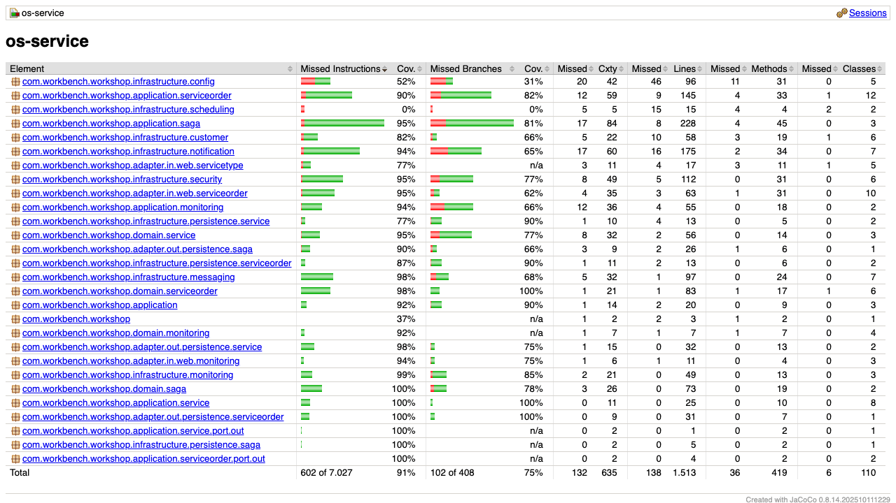

# workbench-os-service — OS Service

[](https://sonarcloud.io/summary/new_code?id=TechChalleng-FIAP-SOAT_workbench-os-service) [](https://sonarcloud.io/component_measures?id=TechChalleng-FIAP-SOAT_workbench-os-service&metric=coverage)

Microsserviço de **Ordem de Serviço (OS)** e **orquestrador da Saga** da plataforma
Workbench (Tech Challenge — FIAP Pós Tech, Fase 4).

> **Contexto (Fase 4):** na Fase 3 a oficina era um **monólito** (`workbench-monolith`,
> mantido como base histórica). Na Fase 4 a aplicação foi refatorada em
> **microsserviços independentes**, cada um com seu repositório, infraestrutura e
> banco próprios. Este repositório é o **OS Service** — o coração do fluxo e o
> **orquestrador central** da Saga que coordena os demais serviços. A divisão dos
> serviços e a estratégia da Saga estão documentadas nos ADRs
> (`workbench-monolith/docs/adr` — ADR-0006 e ADR-0005).

---

## Sumário

- [Responsabilidades](#responsabilidades)
- [Requisitos obrigatórios do PDF cobertos aqui](#requisitos-obrigatórios-do-pdf-cobertos-aqui)
- [Estratégia da Saga (orquestrada)](#estratégia-da-saga-orquestrada)
- [Arquitetura da aplicação (hexagonal)](#arquitetura-da-aplicação-hexagonal)
- [Arquitetura de infraestrutura](#arquitetura-de-infraestrutura)
- [Fluxo de Deploy (CI/CD)](#fluxo-de-deploy-cicd)
- [Tecnologias](#tecnologias)
- [Como executar localmente](#como-executar-localmente)
- [Deploy em Kubernetes / AWS](#deploy-em-kubernetes--aws)
- [Referência de endpoints](#referência-de-endpoints)
- [Testes e cobertura](#testes-e-cobertura)
- [Documentação da API (Swagger)](#documentação-da-api-swagger)

---

## Responsabilidades

- Abertura da OS (cliente por CPF/CNPJ, veículo por placa, tipos de serviço)
- **Diagnóstico**: registro das peças a reservar e da mão de obra por serviço; inicia a Saga
- Máquina de estados da OS, validada no domínio
- **Orquestração da Saga**: coordena Execution e Billing, com estado persistido e compensações
- Decisão do orçamento pelo cliente (aprovar/recusar), com **validação de ownership**
  (um cliente só decide a OS do próprio CPF; staff decide qualquer uma)
- **Nova cobrança** quando o pagamento é recusado/cancelado (`POST /order/{id}/payment-retry`)
- Catálogo de tipos de serviço com custo de mão de obra (editável via API)
- Consulta de status, listagem priorizada e **histórico** por documento
- **Notificação de status ao cliente** por e-mail (paridade com o monólito): a cada
  mudança de status, envia uma mensagem formatada. O canal é escolhido por configuração:
  tópico SNS (padrão; o e-mail vai para quem está inscrito nele) ou **Amazon SES**, que
  envia direto ao e-mail do cliente, resolvido no Customer Service por REST
  (ver [SNS × SES](#e-mail-ao-cliente-sns--ses))
- **Monitoring**: relatório de tempo médio de execução dos serviços

Fluxo (máquina de estados — ADR-0005):

```
RECEBIDA → EM_DIAGNOSTICO → AGUARDANDO_APROVACAO → APROVADO → EM_EXECUCAO
  → FINALIZADA → PAGAMENTO_PENDENTE → PAGO → ENTREGUE
                        └→ (recusa) RECUSADA
```

---

## Requisitos obrigatórios do PDF cobertos aqui

| Requisito (PDF Fase 4) | Como este serviço atende |
|---|---|
| ≥3 microsserviços independentes | É um dos 4 serviços (OS, Billing, Execution, Customer), com repo/infra/banco próprios |
| Banco próprio | **PostgreSQL** exclusivo; nenhum outro serviço o acessa |
| SQL **e** NoSQL (no conjunto) | Contribui com o **SQL** (PostgreSQL); o NoSQL fica no Execution (MongoDB) |
| Nenhum acesso ao banco de outro serviço | Valida cliente/veículo no Customer via **REST**; fala com Execution/Billing via **mensageria** |
| REST + mensageria assíncrona | API REST (ciclo da OS) + **SNS/SQS** (comandos/eventos da Saga) |
| **Saga Pattern + rollback/compensação** | **Orquestrador central** (ver seção da Saga); compensação na recusa/falha de orçamento |
| Testes + 80% cobertura + Sonar | JaCoCo com gate de 80% no `verify` + SonarCloud no CI (cobertura atual ~90%) |
| CI/CD + deploy K8s + branch protegida | Pipeline próprio (build→testes→qualidade→imagem→deploy EKS); `main` protegida |

---

## Estratégia da Saga (orquestrada)

> O PDF exige **documentar e justificar** a escolha entre orquestração e coreografia.

Escolhemos **Saga orquestrada**, com o **OS Service como orquestrador central**. O
estado da Saga é **persistido** (tabela `saga_state`: passo atual, passos concluídos,
comando pendente, tentativas) para sobreviver a reinícios.

**Por que orquestrada e não coreografada:**
- O fluxo tem **pausas humanas** (aprovação do orçamento, pagamento pelo cliente) e
  ramificações (recusa, falha) — mais simples de coordenar e auditar em um ponto central.
- **Compensação explícita**: o orquestrador sabe exatamente o que desfazer e quando.
- **Rastreabilidade**: um único lugar guarda "onde a Saga está" — essencial para o
  monitoramento e a demonstração.

**Fluxo (comandos via SNS→SQS; respostas via eventos):**

```
Diagnóstico ──ComandoReservarEstoque──▶ Execution ──ReservaConfirmada/ReservaFalhou──▶
  ──ComandoGerarOrcamento──▶ Billing ──OrcamentoGerado/OrcamentoFalhou──▶
  (aprovação do cliente) ──ComandoConfirmarReserva──▶ Execution ──ReservaBaixada──▶
  ... execução ... ──ComandoCobrarPagamento──▶ Billing ──CobrancaCriada──▶ (e-mail com link)
  (cliente paga; o Billing consulta o Mercado Pago) ──PagamentoConfirmado──▶ PAGO → ENTREGUE
```

> **Pagamento, passo a passo e com diagrama:** o desenho completo (quem cria a cobrança, quando
> o cliente recebe o link, como o pagamento é detectado, recusa e nova cobrança) está no README do
> Billing, seção **Fluxo de pagamento**
> ([workbench-billing-service](https://github.com/TechChalleng-FIAP-SOAT/workbench-billing-service#fluxo-de-pagamento)).
> O papel **deste** serviço: dispara `ComandoCobrarPagamento` quando a OS entra em
> `PAGAMENTO_PENDENTE`, envia o **e-mail com o link** ao receber `CobrancaCriada`, aceita
> `PagamentoConfirmado` só da rodada atual da Saga e, então, leva a OS a `PAGO` → `ENTREGUE` e
> envia **um e-mail** com o status final. Pagamento recusado envia o aviso **"pagamento não aprovado"** (uma vez por recusa): a OS fica
> retida e o cliente pede nova cobrança em `POST /order/{id}/payment-retry`.

> Nomes, campos obrigatórios e exemplos de cada mensagem estão no contrato executável
> `workbench-messaging/contracts/saga-messages.json`; o `OsSagaContractTest` falha se o
> código divergir dele. No código, os nomes ficam em `SagaMessages` (constantes em inglês,
> valores trafegados em português).

**Compensação / rollback** (princípio do ADR-0005 — *nem toda falha compensa; só se
reverte o que foi efetivado e precisa ser desfeito para manter consistência*):

| Falha | Já efetivado | Ação |
|---|---|---|
| Reserva falha | nada | aborta (tratamento de erro) |
| Orçamento falha (pós-reserva) | reserva `ACTIVE` | **retry**; esgotado → **compensa** liberando a reserva |
| Recusa do orçamento | reserva `ACTIVE` | **compensa** liberando a reserva |
| Pagamento falha (pós-execução) | estoque baixado + peça instalada | **retém** em `PAGAMENTO_PENDENTE` (não reverte estoque); a Saga segue aguardando pagamento e o cliente/equipe pede **nova cobrança** (`/payment-retry`) |

**Robustez:**
- O `saga_state` guarda o comando pendente e o instante do envio; um job `@Scheduled` +
  **ShedLock** reenvia comandos vencidos (timeout) e, esgotadas as tentativas, compensa
  quando a etapa é reversível.
- **Eventos repetidos ou fora de ordem são descartados:** cada evento só é aceito no passo
  da Saga em que é esperado (o SQS entrega "pelo menos uma vez").
- **Comandos e e-mails só saem depois do commit** (`AfterCommit`): uma resposta rápida
  nunca encontra a Saga ainda não gravada, e um rollback não deixa mensagem enviada.
- Os participantes são idempotentes (reserva, cobrança e estorno repetidos não duplicam).

---

## Por que este banco

**PostgreSQL**, porque a OS é uma máquina de estados com regras que o banco garante: transição de status, serviços da OS ligados a ela e o estado da Saga com **trava otimista** (`version`), que impede duas decisões simultâneas de gravarem as duas. Schema versionado por Flyway.

As demais decisões (MongoDB no execution, Saga orquestrada, SNS/SQS, EKS, Lambda…) estão respondidas uma a uma em `workbench-technical-documentation/01 - Arquitetura/Decisoes de Arquitetura.md`, com links para as ADRs.

---

## Arquitetura da aplicação (hexagonal)

Arquitetura **Hexagonal (Ports & Adapters)**: o domínio não depende de frameworks.

```
src/main/java/com/workbench/workshop/
├── adapter/
│   ├── in/web/            # Controllers REST (serviceorder, servicetype)
│   └── out/persistence/   # Adapters JPA + adapter de Saga
├── application/           # Use cases (uma classe por caso de uso) + ports
│   ├── AfterCommit, Requester  # efeitos pós-commit; quem pede (regra de dono)
│   ├── saga/              # SagaOrchestrator, SagaMessages + ports (SagaCommandPort, SagaStateRepository)
│   ├── serviceorder/      # Create/Update/Diagnose/Decide/RetryPayment/Find + ports
│   └── service/           # Tipos de serviço e serviços da OS
├── domain/                # Domínio puro
│   ├── saga/              # SagaState, SagaStep
│   ├── serviceorder/      # ServiceOrder (rich domain), máquina de estados, Decision
│   └── service/           # WorkshopService, ServiceType
└── infrastructure/        # config, persistence (JPA), messaging (SNS/SQS), scheduling (ShedLock), security
```

---

## Arquitetura de infraestrutura

Cada microsserviço tem **banco próprio** e roda em um **namespace** dedicado dentro
de um **cluster EKS compartilhado** pela plataforma (`workbench-platform-<env>`,
provisionado pelo `workbench-k8s-terraform`). Não há acesso cruzado a bancos.

```
┌───────────────────────── EKS: workbench-platform-<env> ─────────────────────────┐
│  ns: os-service        ns: billing-service   ns: execution-service  ns: customer │
│  ┌──────────────┐      ┌──────────────┐      ┌──────────────┐    ┌────────────┐  │
│  │ os-service   │      │ billing      │      │ execution    │    │ customer   │  │
│  │ + PostgreSQL │      │ + PostgreSQL │      │ + MongoDB    │    │ +PostgreSQL│  │
│  └──────┬───────┘      └──────────────┘      └──────────────┘    └────────────┘  │
│         │ orquestra via SNS/SQS (workbench-messaging)                            │
└─────────┼────────────────────────────────────────────────────────────────────── ┘
          └─▶ SNS tópicos / SQS filas + DLQ (repo workbench-messaging)
```

- **Banco**: PostgreSQL próprio, schema versionado por **Flyway**.
- **Mensageria**: tópicos/filas provisionados no repo `workbench-messaging` (SNS/SQS,
  LocalStack em dev / AWS em produção).

---

## Fluxo de Deploy (CI/CD)

Pipeline independente (`.github/workflows/pipeline.yml`):

```
push (main/develop) ou PR
   │
   ▼
unit-test ──▶ code-analysis ──▶ build ──▶ docker-build-push ──▶ deploy-aws
(mvn verify   (JaCoCo gate 80%  (mvn      (imagem p/ Docker Hub  (EKS, só se
 + JaCoCo      + Sonar)          package)  usuario/os-service)    USE_AWS=true)
 badge)
```

- Gate de cobertura **80%** (JaCoCo `check`) na fase `verify`.
- `deploy-aws` anexa ao cluster `workbench-platform-<branch>` e aplica os manifests `k8s/`.

### Secrets/variáveis (GitHub Actions)

| Nome | Escopo | Uso |
|---|---|---|
| `DOCKER_USERNAME`, `DOCKER_HUB_TOKEN` | org | push da imagem |
| `SONAR_TOKEN` | org/repo | análise SonarCloud (sem ele, roda só o gate local) |
| `AWS_ACCESS_KEY_ID_<ENV>`, `AWS_SECRET_ACCESS_KEY_<ENV>`, `AWS_REGION` | org | deploy EKS |
| `DB_URL_OS_<ENV>`, `DB_USERNAME_OS`, `DB_PASSWORD_OS` | org | banco da OS (injetados no Secret do pod) |
| `JWT_PUBLIC_KEY` | org | chave pública RS256 da Lambda de login (a mesma em todos os serviços) |
| `JWT_SERVICE_PRIVATE_KEY` | org | chave privada do token de serviço que o os-service usa ao chamar o customer (restrinja o secret a este repositório) |
| `DD_API_KEY` | org | (opcional) Datadog Agent + métricas |
| `USE_AWS` (variable) | org/repo | `true` habilita o deploy no EKS |

> O `k8s/secret.yaml` só tem placeholders (`REPLACE_ME`) e **não é aplicado**: o job
> `deploy-aws` monta o Secret do pod a partir dos secrets acima e falha logo no início
> ("Validar secrets obrigatórios") se faltar algum.

---

## Tecnologias

| Tecnologia | Finalidade |
|---|---|
| Java 21 + Spring Boot 4.0.9 | Framework web e DI |
| PostgreSQL 16 + Flyway | Banco próprio (SQL) + migrations |
| AWS SNS/SQS (SDK v2) | Mensageria da Saga (comandos/eventos) + DLQ |
| ShedLock (JDBC) | Lock distribuído dos jobs agendados (HPA) |
| Spring Security + JWT (RS256) | Validação de token com a chave pública da Lambda |
| Micrometer + Datadog | Métricas de negócio e observabilidade |
| SpringDoc OpenAPI | Swagger UI |
| JaCoCo (gate 80%) + SonarCloud | Qualidade e cobertura |
| Testcontainers | Testes de integração com PostgreSQL real |

---

## Como executar localmente

Pré-requisitos: Java 21, Docker (para Testcontainers), um PostgreSQL acessível.

```bash
./mvnw spring-boot:run -Dspring-boot.run.profiles=local
```

> **Sem valores padrão para segredos.** Fora do perfil `local` (`JWT_PUBLIC_KEY`, `JWT_SERVICE_PRIVATE_KEY` e a senha do banco) são
> obrigatórios: sem eles o serviço não sobe. O perfil `local` (`application-local.yml`)
> traz os valores de desenvolvimento e é ativado pelo compose do `workbench-messaging`.

O Flyway cria o schema na subida. Configuração relevante (env):

| Variável | Default | Descrição |
|---|---|---|
| `SPRING_DATASOURCE_URL` / `_USERNAME` | Postgres local | Banco próprio da OS |
| `SPRING_DATASOURCE_PASSWORD` | — (obrigatório; dev no perfil `local`) | Senha do banco |
| `JWT_PUBLIC_KEY` | — (obrigatório; em dev vem do `.env` do compose, gerado por `workbench-messaging/scripts/dev-keys.sh`) | Chave **pública** RS256 da Lambda de login: o serviço verifica token, não emite |
| `JWT_SERVICE_PRIVATE_KEY` | — (obrigatório; dev no perfil `local`) | Chave privada do token de serviço (`kid=os-service`) usado nas chamadas ao customer |
| `MESSAGING_ENABLED` | `false` | Liga SNS/SQS; `false` usa adapters no-op (sem broker) |
| `ORDER_EVENTS_TOPIC_ARN` | — | Tópico onde o orquestrador publica os comandos da Saga |
| `SAGA_REPLIES_QUEUE_URL` | — | Fila de onde o orquestrador lê as respostas da Saga |
| `AWS_ENDPOINT` | — | vazio = AWS real; `http://localhost:4566` = LocalStack |
| `CUSTOMER_VALIDATION_ENABLED` | `false` | Valida cliente/veículo no Customer via REST; também habilita a busca do e-mail do cliente para a notificação |
| `CUSTOMER_SERVICE_URL` | — | URL base do Customer Service |
| `CUSTOMER_CONNECT_TIMEOUT` / `CUSTOMER_READ_TIMEOUT` | `2s` / `5s` | Timeouts das chamadas ao Customer Service (um Customer travado não prende a requisição) |
| `SCHEDULING_POOL_SIZE` | `4` | Threads dos jobs `@Scheduled` (consumidor SQS e timeout da Saga não dividem uma thread só) |
| `NOTIFICATIONS_TOPIC_ARN` | — | Tópico SNS de notificação de status ao cliente (e-mail). Sem ele, a notificação é ignorada. Só vale no canal `sns` |
| `NOTIFICATION_CHANNEL` | `sns` | Canal do e-mail ao cliente: `sns` (publica no tópico) ou `ses` (envia direto ao e-mail do cliente) |
| `SES_SENDER_EMAIL` | — | Remetente verificado no SES. **Obrigatório com `NOTIFICATION_CHANNEL=ses`**: sem ele o serviço não sobe |

### E-mail ao cliente: SNS × SES

| | `sns` (padrão) | `ses` |
|---|---|---|
| Para quem vai | **Para quem estiver inscrito no tópico** (um endereço fixo, `notification_email` do Terraform). O e-mail do cliente vai só como atributo da mensagem, sem filtro | Para o **e-mail cadastrado do cliente** no Customer Service |
| Cliente sem e-mail | Publica mesmo assim | Não envia e registra no log |
| Infra | Tópico + assinatura | Remetente verificado no SES (`workbench-messaging/ses.tf`) e permissão `ses:SendEmail` nos nós (`workbench-k8s-terraform`) |

Uma conta nova do SES está em **sandbox**, onde só se envia de remetente verificado **para
destinatário verificado**. Para mandar a qualquer cliente, a AWS precisa aprovar o acesso à
produção: o pedido está em `workbench-messaging/scripts/ses-request-production.sh`. O serviço já
envia pelo *configuration set* `workbench-customer-email` (`SES_CONFIGURATION_SET`, a pipeline
define), que manda bounces e reclamações ao tópico de alertas — um requisito da AWS para a produção. Cada identidade verificada
recebe um e-mail da AWS com um link que o dono precisa abrir. A falha de envio nunca reverte a OS
(best-effort). O LocalStack da comunidade não tem SES; localmente o canal fica em `sns`.

---

## Deploy em Kubernetes / AWS

Manifests em `k8s/` (`namespace`, `configmap`, `secret`, `app`, `hpa`). O deploy é
automatizado pelo pipeline (job `deploy-aws`, quando `USE_AWS=true`), que roda
`aws eks update-kubeconfig --name workbench-platform-<branch>` e aplica os manifests
no namespace `os-service`. Provisionar o cluster/credenciais AWS é pré-requisito
(ver `workbench-k8s-terraform` e o guia `workbench-technical-documentation/09 - Operacao/Deploy na AWS.md`).

O que os manifests garantem:
- **Rede:** o Service é um **NLB interno** (`aws-load-balancer-internal`), alcançável só de dentro da VPC. O tráfego de fora entra pelo API Gateway (VPC Link + authorizer JWT); Swagger e actuator não ficam na internet. Se o Service já existia como LB público, o pipeline o recria uma vez (o esquema de um LB não muda depois de criado). Uma `NetworkPolicy` deixa entrar só a porta 8080 (vale com NetworkPolicy ligada no VPC CNI).
- **Imagem:** o pipeline troca o `REPLACE_IMAGE` do `app.yaml` pela tag do commit antes do `kubectl apply` (um rollout por deploy). Não há tag `:latest`; o `dd-java-agent` injetado pelo Datadog tem versão fixa (`v1.68.2`).
- **Pods:** usuário não-root (UID 10001), sem escalar privilégio, sem capabilities, sistema de arquivos somente leitura (só `/tmp` gravável), `seccomp` padrão. A subida tem um `startupProbe` (até 5 min); liveness e readiness começam depois. A JVM usa até 75% da memória do container (`-XX:MaxRAMPercentage=75.0`).
- **Escala:** o número de réplicas é só do HPA (o `Deployment` não fixa `replicas`), e um `PodDisruptionBudget` tira no máximo 1 pod por vez numa troca de nó.

---

## Referência de endpoints

| Método | Rota | Descrição |
|---|---|---|
| POST | `/order` | Criar OS (valida cliente/veículo no Customer Service) |
| GET | `/order` | Listar OS ativas (priorizadas) |
| GET | `/order/id/{id}` | Buscar OS por ID |
| GET | `/order/document/{cpfCnpj}` | Histórico de OS por documento |
| PATCH | `/order/{id}` | Atualizar status da OS (`FINALIZADA` exige todos os serviços `DONE`) |
| POST | `/order/{id}/diagnosis` | Registrar diagnóstico (peças + MO) e iniciar a Saga (de novo, se ela falhou) |
| GET | `/order/{id}/saga` | Estado da Saga: passo atual, passos concluídos e motivo da falha |
| GET | `/order/{id}/services` | Serviços da OS com status (`TO_DO`/`DOING`/`DONE`) e histórico |
| PATCH | `/order/{id}/services/{serviceId}/status` | Avançar um serviço; o último `DONE` finaliza a OS |
| POST | `/order/{id}/decision` | Aprovar/recusar o orçamento (cliente só decide a própria OS; staff decide qualquer uma) |
| POST | `/order/{id}/payment-retry` | Nova cobrança após pagamento recusado/cancelado (novo link por e-mail; 202) |
| GET | `/service-types` | Listar tipos de serviço (com custo de MO) |
| GET | `/service-types/{id}` | Buscar tipo de serviço |
| POST | `/service-types` | Criar tipo de serviço (nome normalizado e único) |
| PUT | `/service-types/{id}` | Atualizar descrição e MO de um tipo |
| PUT | `/service-types/{id}/labor-cost` | Atualizar só custo/horas de MO de um tipo |
| DELETE | `/service-types/{id}` | Excluir tipo de serviço |
| POST | `/monitoring/all` | Tempo médio de execução por tipo de serviço (SECONDS/MINUTES/HOURS) |
| POST | `/monitoring/by-id` | Tempo de execução de um serviço específico |

> **Autorização:** `GET /order/document/**`, `POST /order/{id}/decision` e
> `POST /order/{id}/payment-retry` aceitam **CLIENT** (além do staff); as demais exigem
> ADMIN/TECHNICIAN. Com token de **cliente**, o dono é conferido no caso de uso: só o
> próprio CPF (consulta, decisão e nova cobrança) — outro CPF recebe **403**.
>
> **PATCH de status:** numa OS conduzida pela Saga, os status que a Saga decide
> (`AGUARDANDO_APROVACAO`, `APROVADO`, `RECUSADA`, `PAGO`, `ENTREGUE`) são recusados
> (**409**) — use `/decision` ou aguarde o pagamento. Sem Saga (modo manual) seguem livres.
>
> **Customer Service fora do ar:** a criação da OS responde **503** com mensagem
> genérica (o detalhe técnico fica só no log).

> **Chamadas internas (token de serviço):** ao validar cliente/veículo e resolver o
> e-mail no Customer Service, o OS Service usa um **token de serviço** (staff, curta
> duração) emitido pelo `ServiceTokenProvider` com a chave privada do os-service (`kid=os-service`; só o customer confia nela) — porque
> todos os serviços agora exigem token, inclusive em threads assíncronas da Saga.

> **Pagamento automático + link ao cliente:** quando a OS entra em `PAGAMENTO_PENDENTE`,
> o OS Service comanda o Billing a criar a cobrança (Saga); ao receber `CobrancaCriada`,
> envia o **link de checkout** por e-mail (ao cliente com o canal SES; com o SNS, ao endereço
> inscrito no tópico). O cliente também pode consultar o
> link em `GET {billing}/api/payments/service-order/{osId}` (campo `checkoutUrl`). A
> confirmação chega quando o Billing vê o pagamento aprovado no Mercado Pago.

### Boas práticas OWASP aplicadas
- **A01/A07:** autorização por role em todas as rotas; ownership para cliente na consulta
  por documento, na decisão do orçamento e na nova cobrança; JWT validado pelo serviço.
- **A03 (validação):** Bean Validation nos DTOs; acesso a dados via Spring Data JPA
  parametrizado (a única query nativa é estática, sem input concatenado).
- **A05:** headers `X-Frame-Options: DENY` + `nosniff`; `k8s/secret.yaml` só com placeholders
  (`REPLACE_ME`) — os valores reais vêm dos secrets da org, montados pela pipeline; erro de
  dependência responde mensagem genérica (503) sem expor detalhe interno.
- **A09:** CPF do cliente mascarado no log (MDC).

> Hotspot `java:S4502` (CSRF disabled) marcado **Safe**: API REST stateless com JWT.

> **Monitoring** (paridade com o monólito): relatório gerencial de tempo médio de
> execução, medido entre o primeiro `DOING` e o primeiro `DONE` de cada serviço.

---

## Testes e cobertura

```bash
./mvnw verify          # unit + integração (Testcontainers) + gate de cobertura
```

- **Gate JaCoCo 80%** na fase `verify` (o build falha abaixo disso).
- Integração com **Testcontainers PostgreSQL** (sobe um Postgres real em container).
- **Teste de contrato da Saga** (`OsSagaContractTest`): confere os nomes de mensagem, os
  campos obrigatórios dos comandos que o orquestrador publica e se ele aceita os eventos de
  exemplo do contrato (`src/test/resources/contracts/saga-messages.json`, cópia da fonte
  única em `workbench-messaging/contracts` — sincronize com `sync-saga-contract.sh`).
- Cobertura atual (medida em 2026-11-16): **90,9% de linhas** e 75,0% de branches. O relatório fica em `target/site/jacoco/index.html`.

  Relatório JaCoCo do `mvn verify` sobre a `main` em 2026-11-16 (a linha **Total** é a cobertura
  do serviço; a coluna *Lines* mostra linhas perdidas/total):

  

  O badge *Coverage* no topo vem do SonarCloud, que mede a branch `main` (o número dele é um
  pouco diferente porque o Sonar conta linhas e condições juntas).

- Evidência por execução do CI: artefato `jacoco-report` do job `unit-test` (relatório HTML) e o Quality Gate do SonarCloud no job `code-analysis`.

---

## Documentação da API (Swagger)

| Recurso | URL (local) |
|---|---|
| Swagger UI | http://localhost:8080/swagger-ui/index.html |
| OpenAPI JSON | http://localhost:8080/v3/api-docs |

> **Collection Postman** deste serviço: `postman/os-service.postman_collection.json`.
> Collection unificada da plataforma (+ fluxo Saga E2E): `workbench-technical-documentation/postman`.
